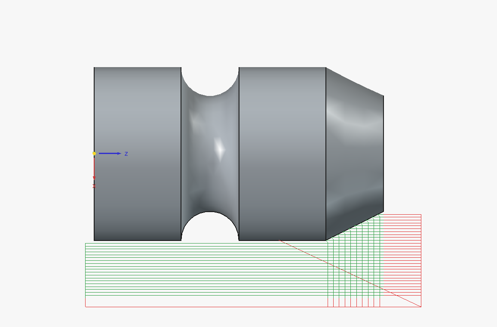
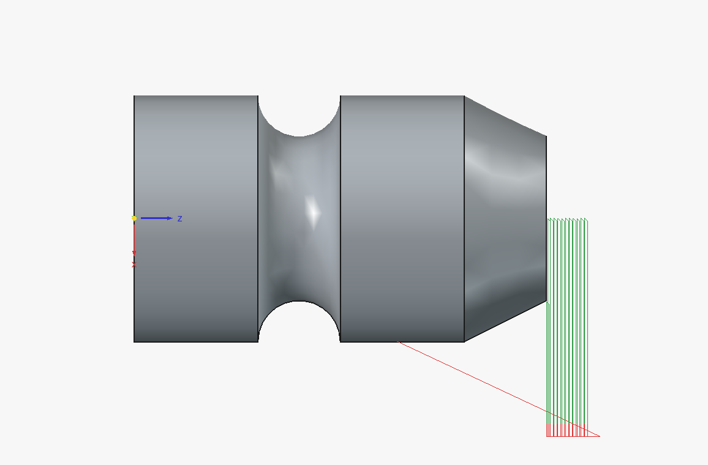
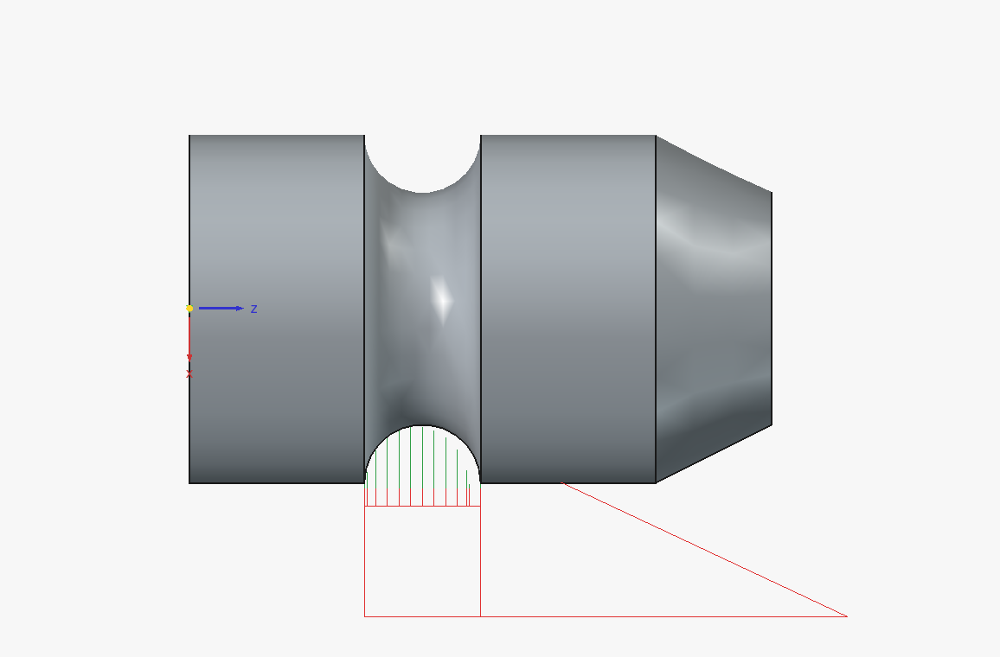
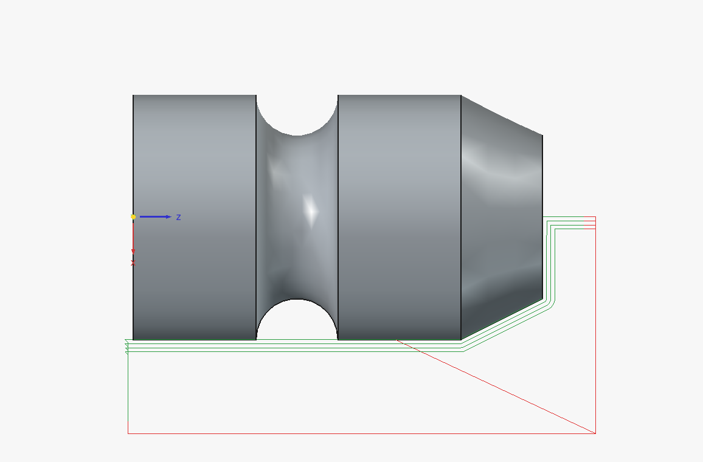
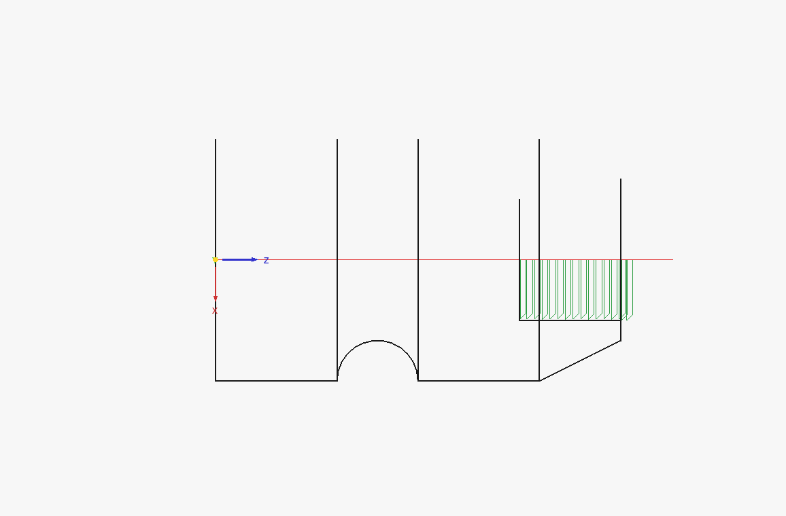
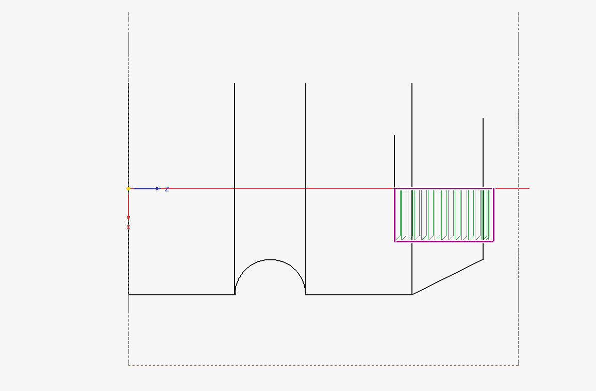
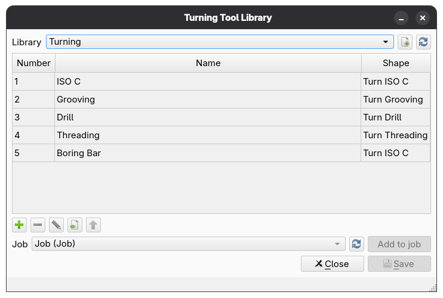
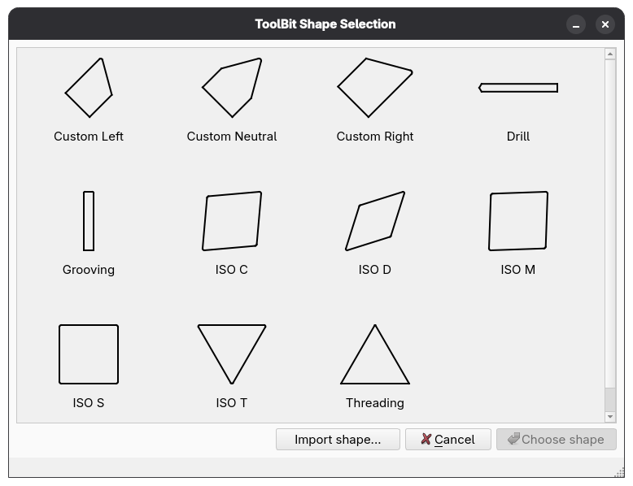
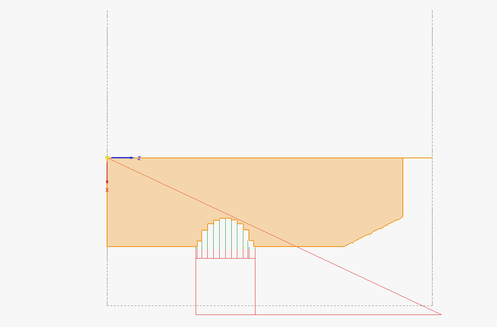
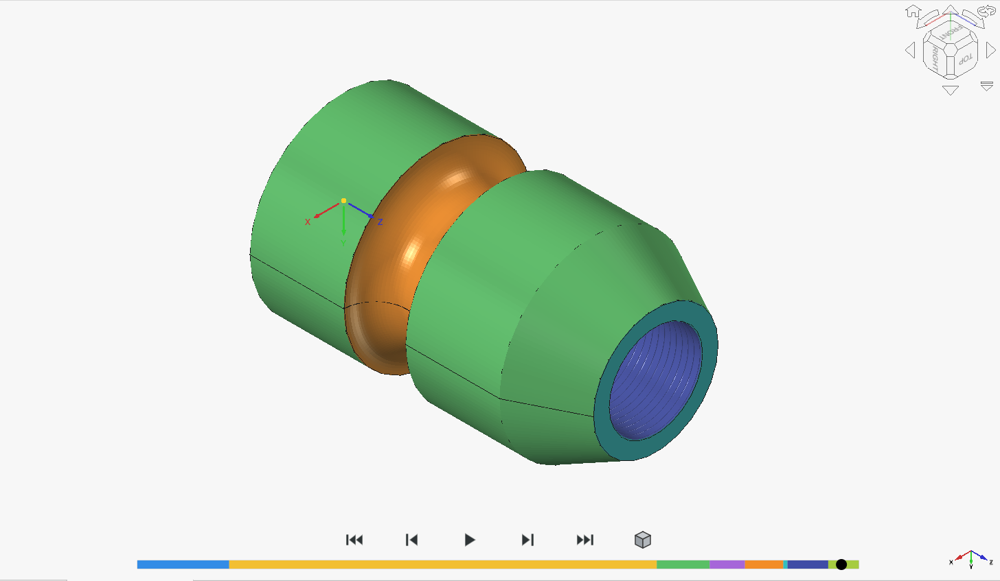

# FreeCAD Turning Addon

A FreeCAD CAM workbench addon for creating CNC lathe toolpaths.

> **Experimental:** This addon is under development. Review and verify every toolpath before machining.

## Features

- Turning roughing, including facing and grooving
- Turning profiling, parting, threading, and drilling
- A turning tool library and toolpath simulation
- Containment controls and a remaining-stock guide

## Requirements

- FreeCAD 26.3 or later
- [LibLathe](https://pypi.org/project/liblathe/)

The addon is available from **CAM > CAM Addons > Turning Addon**.

## Turning operations

<table>
  <tr>
    <td align="center"><strong>Roughing</strong> </td>
    <td align="center"><strong>Facing</strong> </td>
  </tr>
  <tr>
    <td align="center"><strong>Grooving</strong> </td>
    <td align="center"><strong>Profiling</strong> </td>
  </tr>
  <tr>
    <td align="center"><strong>Boring</strong> </td>
    <td align="center"><strong>Containment</strong> </td>
  </tr>
</table>

## Tools and simulation

Use the **Turning Tool Library** to create and edit tools. The containment controls set operation bounds, and the remaining-stock guide shows stock before or after an operation. Use **Turning Simulation** to preview a toolpath.

<table>
  <tr>
    <td align="center"><strong>Tool library</strong> </td>
    <td align="center"><strong>ToolBit shapes</strong> </td>
  </tr>
  <tr>
    <td align="center"><strong>Remaining-stock guide</strong> </td>
    <td align="center"><strong>Simulation</strong> </td>
  </tr>
</table>

## License

[LGPL-2.1](LICENSE)
